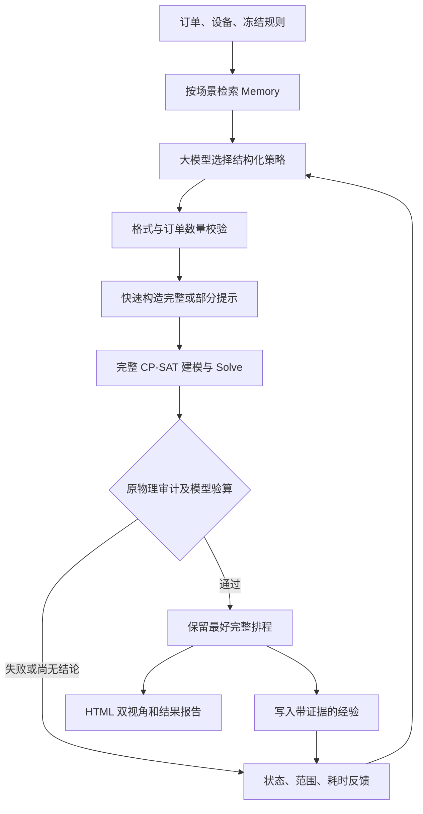

# 架构与参考来源

## 流程

目标、规则、策略分别管理。首日净锻打分钟数是主目标；可选保温偏好只在主目标相同的情况下排序。炉子容量、温度兼容、空炉换温、车辆位置与空驶、即时接走、四天内全部完成等仍由原模型约束。

## 与两个本地 Harness 对齐的部分

| 参考 | 本项目采用 | 本项目位置 |
|---|---|---|
| DeepSeek Harness 的分层执行 | 模型规划、工具执行、交付校验分别负责 | `client.ts`、`worker.ts`、`python/worker.py` |
| DeepSeek Harness 的先持久化再投影 | 事件先写 JSONL，再显示终端信息 | `events.ts` |
| DeepSeek Harness 的流式生命周期 | 调用开始、接收进度、完成/错误；答复未完整前不可执行 | `client.ts` |
| Qwen Live Harness 的结构化 Memory | SQLite、自有上下文、有限检索、证据记录 | `memory.ts` |
| Qwen Live Harness 的写入边界 | 实测事实与模型推测分开；幂等写入；匹配规则版本 | `memory.ts`、`contracts.ts` |

本地参考目录为 `deepseek-harness` 与 `Qwen-Live-Harness`。本项目采用相同的 Node.js / TypeScript 主编排技术栈，并借鉴上述结构；**没有直接安装或声称运行它们的完整框架**。CP-SAT 保留 Python SDK，因为原模型和独立审计都在 Python 中；跨语言边界使用 JSON 文件与事件协议，不经过 shell 拼接执行模型输出。

## 策略与求解的边界

- 分组、优先规则、种子决定如何产生提示，不改变 CP-SAT 的可行域。
- 没有已有方案时，完整或部分提示进入全局模型；CP-SAT 可以偏离提示。
- 有已有方案后，模型可选择全局改进，或释放部分订单做局部改进。
- 局部模型增加的固定条件仅限定本次搜索范围，不写回原工艺/规则。
- 有效完整方案、尚未补全的提示、`UNKNOWN`、局部 `INFEASIBLE` 分开记录。
- “达到目标”与“证明最优”分开；没有界证明时不使用“最优”描述结果。

## Memory 的内容与限制

一条经验包含规则版本、工艺/资源指纹、订单数量、期限、策略、实测状态、分数、耗时和证据路径。模型的 `hypothesis` 不会自动升级为因果结论。不同车辆数量、换温速率或硬规则不会混为相同经验。

初始版本使用结构化匹配，未引入向量数据库或第二个模型总结器。这便于准确区分同一个场景复用与相似场景建议。较好成绩对应的策略可以再次尝试，但每次仍须用当前订单求解、审计，不能直接宣布历史方案可用。只保存策略而非自动复用整张历史排程。

相似订单的经验不保证迁移有效。输入路线/温控条件变化时宁可不命中，也不混入不适用的硬约束建议。当前运行只有启动时从库中检索，运行内通过实测反馈累积上下文；下一次运行重新检索更新后的库。

## 可复现性与时间口径

- 运行保存输入副本、规则指纹、模型最终答复、实际策略、每次求解参数和完整日志。
- 端到端时间从启动开始，包含 Memory 检索、API 等待及思考、构造、建模、CP 搜索、审计和交付写入。
- `api_wall_s` 与 `worker_wall_s` 是不同层级；`cp_solver_wall_s`、`construction_s`、`audit_s` 已包含在 worker 时间中，不能再次相加成总耗时。
- 16 线程 CP-SAT 的运行有波动。单次对照不能证明普遍加速，冷启动与 Memory 复用必须单独列出。
- 原来的完整模型验算函数仍不是求解器；真正求解证据来自新增 worker 中的 `solver.solve()`、回调数及 `solver.log`。

## 尚未包含

- 动态插单、设备故障、实际在制状态接入；当前是原 20 单冷启动条件。
- 模型修改构造器源码、自由执行代码或改变物料工艺。
- 多个模型同时规划、多 CP 任务同时运行；本版串行试策略、CP 内部并行，避免把并发收益混入首次效果验证。
- 同时变更首日目标和成材率模型；保温项仍是可选偏好。
- 无时限守护、自动恢复中断任务、自动放宽约束。

## 首轮测试后调整

首轮逐候选“构造一次就调用 CP”的方式浪费了计算机会。当前先便宜地跑完本批构造，再按完整候选得分排序安排 CP；模型的计划顺序与实际执行顺序分别保存。构造部分得分仅用于诊断，不作为可交付成绩。

Memory 还记录局部改进之前的基线、该次构造得分和求解模式，避免把“在别人的基线之上改进到 547 分钟”误记为“这个构造配置从零就能得到 547 分钟”。
